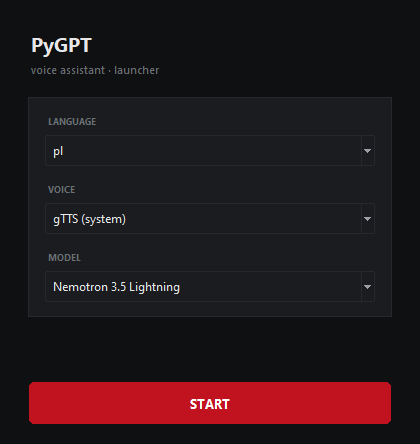

# PyGPT — local voice assistant

PyGPT is a desktop voice assistant for Windows and Linux. It combines a chat model
from [NagaAI](https://naga.ac/), speech recognition (Wav2Vec2) and speech synthesis
(VALL-E X or gTTS) in one dark, minimal Tkinter interface. You can type or just hold
the microphone button and talk — the answer is spoken back in the voice you picked,
with a live oscilloscope showing the waveform.


## Features

- **Chat with free NagaAI models** — nine `:free` models listed at start-up
  (Nemotron 3.5 Lightning, Nemotron 3 Ultra, Llama 3.3 70B, Xing 4.0, Flint, …).
  The list is refreshed from `https://api.naga.ac/v1/models` in the background,
  with an offline fallback.
- **VALL-E X voices** — Paimon, Bronya, Fu Xuan, Yae Sakura, Seele, Rosalia,
  VCTK, LibriSpeech and more. Every `.npz` in `presets/` becomes a voice in the
  launcher (33 presets shipped).
- **gTTS fallback** — Google Text-to-Speech, used for Polish and for people who
  do not want to load the neural voice model.
- **Speech recognition** — Polish (`alexcleu/wav2vec2-large-xlsr-polish`) or
  English (`jonatasgrosman/wav2vec2-large-xlsr-53-english`).
- **Per-character avatars** — every voice has its own icon in `assets/`; drop in a
  transparent PNG to replace it.
- **Real-time waveform** — a Winamp-style oscilloscope under the status bar,
  rendered at ~30 fps while the assistant speaks.
- **Keyboard-first** — `Enter` sends, `Shift+Enter` adds a new line,
  `Space` is a 3-second push-to-talk, `Esc` returns to the input.



## How it works

```
                 ┌──────────────────────────┐
 microphone ───► │ Wav2Vec2 (speech → text) │──┐
                 └──────────────────────────┘  │
                                               ▼
  keyboard ────────────────────────────► ┌───────────┐        ┌──────────────────┐
                                         │  PyGPT    │ ─────► │ NagaAI chat API  │
                                         │ (backend) │ ◄───── │ OpenAI-compatible│
                                         └─────┬─────┘        └──────────────────┘
                                               │ text
                        ┌──────────────────────┴───────────────────────┐
                        ▼                                              ▼
              ┌──────────────────┐                          ┌────────────────────┐
              │ gTTS (Google)    │                          │ VALL-E X + preset  │
              │ mp3 → pydub      │                          │ npz prompt → wav   │
              └────────┬─────────┘                          └─────────┬──────────┘
                       └──────────────► sounddevice ◄─────────────────┘
                                            │
                                     waveform widget
```

1. `main.py` shows the launcher (language, voice, model) and builds the backend.
2. `pygpt.py` owns the chat client, the speech-to-text model and the text-to-speech
   pipeline.
3. `utils/generation.py` runs VALL-E X inference. A voice is a `.npz` file with
   encoded audio + text prompts; `voices.py` finds all of them in `presets/`.
4. `gui.py` renders the chat, plays the audio through `sounddevice` and animates
   the oscilloscope from the same samples that are being played.

## Requirements

| | |
|---|---|
| OS | Windows 10/11 or Linux |
| Python | **3.11** (the installer checks `py -3.11` / `python3.11`) |
| GPU | NVIDIA with ≥ 6 GB VRAM (GTX 1060 or better) for VALL-E X. CUDA is optional — CPU works but is slow |
| Disk | ~10 GB (venv ≈ 5.6 GB, checkpoint ≈ 1.4 GB, model caches ≈ 2.4 GB) |
| Network | Needed for the chat API, gTTS, and the first model download |
| Extras | `ffmpeg` on `PATH` if you want to use gTTS (pydub decodes MP3 with it) |

## Installation

### Windows

```bat
install.bat
```

The script walks you through:

1. **API tokens** — asks for a Hugging Face token and a NagaAI token, saves them in
   `user_tokens/`.
2. **Python 3.11 check**, virtual environment creation in `venv/`.
3. **Model checkpoint** — downloads `checkpoints/vallex-checkpoint.pt` (≈ 1.4 GB).
4. **PyTorch with CUDA 12.1** and everything from `requirements.txt`.
5. **Speech model preload** — downloads the Wav2Vec2 models into `cache_dir/`.

### Linux

```bash
./install.sh
```

Same steps; it expects `python3.11` and `wget` in `PATH`.

### Manual installation

```bash
python3.11 -m venv venv
source venv/bin/activate          # Windows: venv\Scripts\activate

pip install torch torchvision torchaudio --index-url https://download.pytorch.org/whl/cu121
pip install -r requirements.txt

# tokens (one line each, no quotes)
mkdir -p user_tokens
echo "<your-hf-token>"      > user_tokens/hf_token
echo "<your-nagaai-token>"  > user_tokens/nagaai_token

python preload_models.py          # caches the speech-recognition models
```

The VALL-E X checkpoint is downloaded automatically on first start if
`checkpoints/vallex-checkpoint.pt` is missing.

### Tokens

| File | Where to get it | Used for |
|---|---|---|
| `user_tokens/hf_token` | https://huggingface.co/settings/tokens | downloading models |
| `user_tokens/nagaai_token` | https://naga.ac/ | chat completions |

`user_tokens/` is listed in `.gitignore` — **never commit it**.

## Running

```bat
start.bat
```

or

```bash
python main.py
```

`start.bat` launches the app with `pythonw` (no console window). On Linux use
`start.sh` or `python main.py`.

First launch takes a while: the VALL-E X checkpoint (~1.4 GB) is loaded into VRAM
and the VOCOS vocoder weights are downloaded once. Later starts only load the
weights into memory.

## Using the app

### Launcher

| Option | Meaning |
|---|---|
| **Language** | `pl` or `en` — also selects the speech-recognition model |
| **Voice** | `gTTS (system)` or any VALL-E X preset; the icon of the chosen character is previewed next to the list |
| **Model** | one of the free NagaAI chat models |

VALL-E X was trained on English, Chinese and Japanese, and the app always feeds it
English text — so a VALL-E X voice requires **Language = `en`** and the launcher
refuses to start otherwise. Polish is handled by `gTTS`.

### Chat window

| Action | Shortcut |
|---|---|
| Send message | `Enter` |
| New line | `Shift+Enter` |
| Push-to-talk | `Space` (3 s, when the input is not focused) |
| Talk (button) | press and hold the microphone |
| Focus input | `Esc` |

The status bar shows `ready`, `recording`, `thinking`, `generating voice` or
`speaking`. The oscilloscope below it is flat when idle and draws the waveform
while the assistant talks.

## Voices and icons

Every voice is a file in `presets/` (`paimon.npz`, `bronya.npz`, …). Icons live in
`assets/` and are named exactly like the preset:

```
presets/yaesakura.npz   ←  the voice
assets/yaesakura.png    ←  its icon in the launcher and in the chat
```

- PNG with transparency is used as-is; a plain photo is cropped into a circle.
- Supported formats: `.png`, `.webp`, `.jpg`, `.jpeg`, `.gif`.
- To regenerate placeholder icons for all voices (new presets included):

```bash
python tools/make_avatars.py          # skips files that already exist
python tools/make_avatars.py --force  # overwrite everything
```

## Models

Chat models are read from the NagaAI API at start-up; the built-in fallback list is
in `ai_models.py`. Speech models:

| Purpose | Model | Language |
|---|---|---|
| Speech → text | `alexcleu/wav2vec2-large-xlsr-polish` | Polish |
| Speech → text | `jonatasgrosman/wav2vec2-large-xlsr-53-english` | English |
| Text → speech | VALL-E X (`Plachta/VALL-E-X`) | en / zh / ja |
| Text → speech | gTTS | many (incl. Polish) |

## Project structure

```
main.py                 launcher window and application start-up
gui.py                  chat window, message bubbles, waveform, status bar
pygpt.py                backend: chat client, speech-to-text, text-to-speech
voices.py               discovers voice presets and their icons
ai_models.py            free NagaAI models (live list + offline fallback)
token_loader.py         reads API tokens from user_tokens/
preload_models.py       caches the speech-recognition models
macros.py               model constants shared with VALL-E X

models/  modules/  data/     VALL-E X model code
utils/generation.py         VALL-E X inference and preset resolution
utils/g2p/                  phoneme/G2P helpers, BPE tokenizer
utils/sentence_cutter.py    splits long answers into sentences

presets/                *.npz voice prompts (33 voices shipped)
assets/                 voice icons + microphone icon
tools/make_avatars.py   generates placeholder voice icons
docs/                   screenshots
checkpoints/            VALL-E X weights (downloaded, ignored by git)
cache_dir/              Hugging Face cache (downloaded, ignored by git)
```

## Troubleshooting

**`Cannot find prompt <name>`**
The preset file does not exist in `presets/`. The error lists every voice the app
can see. If the folder exists but the app still complains, check that
`utils/generation.py` was not replaced by an older version with hard-coded paths.

**`CUDA NOT FOUND!`**
PyTorch has no CUDA build. Reinstall it with the CUDA index URL shown above, or
accept slow CPU inference.

**No sound / `sounddevice` error**
Pick the right default output device in the system settings; `sounddevice` uses
the default one.

**Microphone records silence**
The recorder opens device index `0`. Set the microphone you actually use as the
default recording device in Windows.

**gTTS fails**
`pydub` needs `ffmpeg` in `PATH`. Install it (e.g. `winget install Gyan.FFmpeg`)
and restart the app.

**First synthesis is slow**
VALL-E X generates audio on demand; a sentence can take a few seconds on a
mid-range GPU. The voice model stays in memory after the first use.

## Notes and limitations

- VALL-E X does not speak Polish — with Polish text the output is gibberish.
  Use gTTS for `pl`.
- Voice presets are the ones shipped with VALL-E X; adding a new `.npz` to `presets/`
  makes it appear in the launcher automatically.
- The chat history lives only in memory; closing the window clears it.
- The `paimon` voice also enables the Paimon persona system prompt; every other
  voice talks like a plain assistant.

## Credits

- [VALL-E X](https://github.com/Plachtaa/VALL-E-X) — text-to-speech model (MIT).
- [gTTS](https://github.com/pndurette/gTTS) — Google Translate TTS client.
- [NagaAI](https://naga.ac/) — OpenAI-compatible chat API.
- [Wav2Vec2](https://huggingface.co/docs/transformers/model_doc/wav2vec2) checkpoints:
  [alexcleu/wav2vec2-large-xlsr-polish](https://huggingface.co/alexcleu/wav2vec2-large-xlsr-polish)
  and [jonatasgrosman/wav2vec2-large-xlsr-53-english](https://huggingface.co/jonatasgrosman/wav2vec2-large-xlsr-53-english).
- Interface built with Python's `tkinter`, audio with `sounddevice` and `pydub`.
